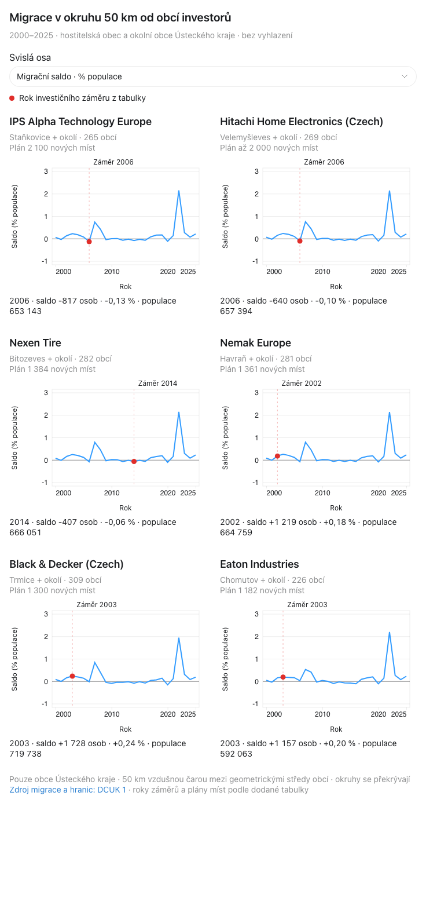
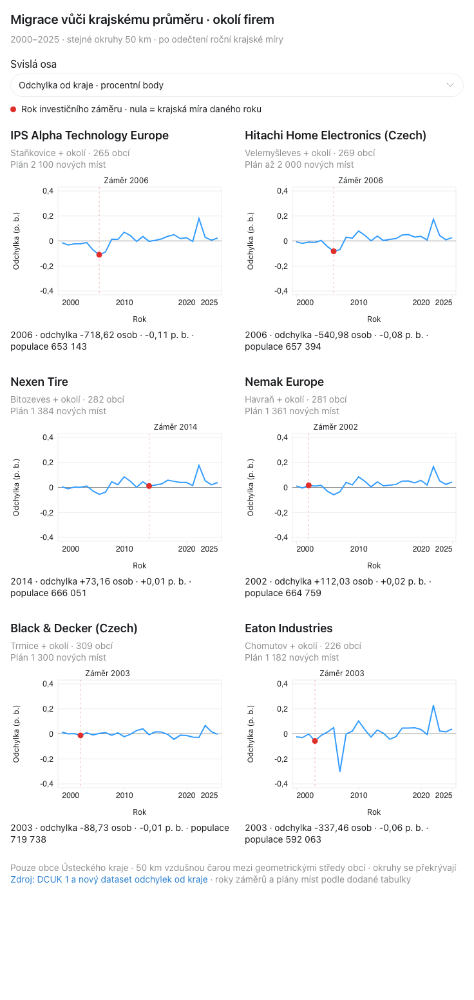
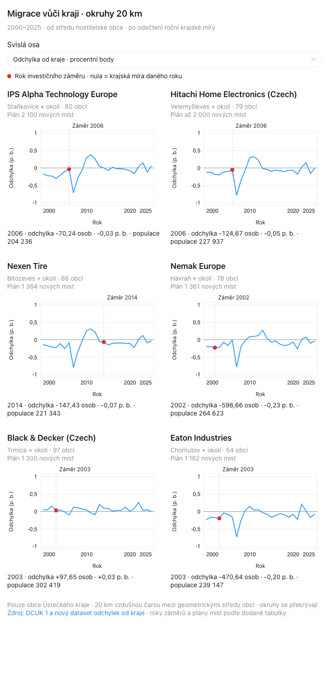
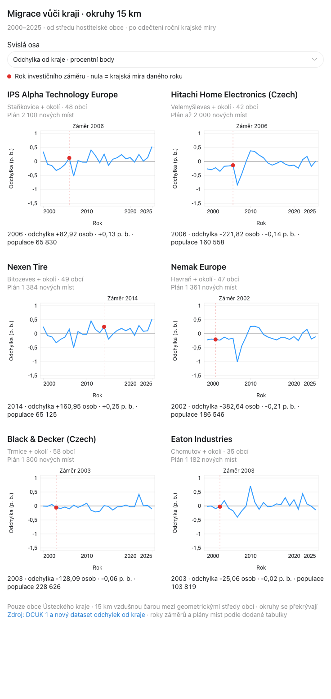

# Hypotéza: nové pracovní příležitosti a migrace

**V této průzkumné analýze jsme nenašli přesvědčivý společný efekt, podle kterého by po investičním záměru všech sledovaných firem následovalo zlepšení migrace v jejich okolí. Výsledky se liší podle firmy, období a velikosti okruhu. Z těchto grafů proto nelze vyvozovat kauzální vliv firem na migraci.**

Jde o dokumentaci jedné části hackathonového průzkumu týmu TT Děčín, stav k 24. 10. 2026. Nejde o důkaz, že firmy na migraci nemají žádný vliv.

## Co jsme chtěli zjistit

Výchozí předpoklad byl: nová pracovní místa mohou přilákat obyvatele, zlepšit migrační saldo a následně zvýšit poptávku po bydlení. Zde jsme zkoumali vztah pracovních příležitostí a migrace; poslední krok tohoto řetězce jsme těmito šesti grafy netestovali.

Přesnější testovatelná hypotéza pro další práci: **Po skutečném zahájení provozu závodu se migrační míra jeho okolí zlepší více než ve srovnatelných oblastech bez obdobné investice.** Současná analýza zatím nemá takovou kontrolní skupinu ani ověřené termíny zahájení provozu všech závodů.

## Sledované firmy

| Rok záměru | Obec | Firma | Plán nových míst |
|---|---|---|---:|
| 2006 | Staňkovice, okres Louny | [IPS Alpha Technology Europe](https://www.forumusteckykraj.cz/podnikatelske/wp-content/uploads/Brozura-Ustecky-kraj-Investori-2018-CZ-FINAL.pdf) | 2 100 |
| 2006 | Velemyšleves | [Hitachi Home Electronics (Czech)](https://czechinvest.gov.cz/cz/Homepage/Novinky/Cervenec-2006/Dalsi-investor-miri-do-Zatce) | až 2 000 |
| 2014 | Bitozeves | [Nexen Tire](https://vlada.gov.cz/scripts/detail.php?id=130841&tmplid=50) | 1 384 |
| 2002 | Havraň | [Nemak Europe](https://www.mpo.gov.cz/assets/dokumenty/26569/26589/295366/priloha001.pdf) | 1 361 |
| 2003 | Trmice | [Black & Decker (Czech)](https://www.mpo.gov.cz/assets/dokumenty/26569/26589/295366/priloha001.pdf) | 1 300 |
| 2003 | Chomutov | [Eaton Industries](https://www.mpo.gov.cz/assets/dokumenty/26569/26589/295366/priloha001.pdf) | 1 182 |

Roky, počty a odkazy pocházejí z pracovní tabulky. **Plánovaná místa nejsou doložené skutečně vytvořené pozice. Červená tečka označuje rok záměru, nikoli ověřené otevření závodu, založení firmy nebo začátek náboru.** Identifikace obcí a lokalizační zdroje jsou v [seznamu firem](data/firmy.json). Pro IPS jde o Staňkovice s kódem `543128`; druhé Staňkovice v kraji jsme nepřipojili.

## Data a způsob výpočtu

- Zdroj: [DCUK 1](https://drive.google.com/drive/folders/1EDqS16kYh4MeiR3dnLPU2_HgnCitau1h), soubory `uloha1_obce_rok_final.csv`, `obce_ciselnik.csv` a `obce_ustecky_kraj.geojson`.
- Roční panel: 354 obcí, roky 2000–2025, celkem 9 204 záznamů. Používáme migrační přírůstek jako přistěhovalí minus vystěhovalí; narození a úmrtí do něj nepatří.
- Populační základ je **stav k 31. 12. stejného roku**. Tato část vychází z dodaného datasetu DCUK; nepřebírá automaticky populační základ ani metodiku ostatních aplikací v repozitáři.
- Okruhy zahrnují hostitelskou obec i obce do 15, 20 nebo 50 km včetně. Vzdálenost je vzdušná mezi geometrickými středy území obcí z původního GeoJSON, počítaná haversine se středním poloměrem Země 6 371,0088 km. Nejde o vzdálenost po silnici ani od brány závodu.
- Výběr obcí je pevný ve všech letech. Zahrnuje pouze dostupné obce Ústeckého kraje; části kruhů v jiných krajích a v Německu nejsou pokryté. Okruhy jednotlivých firem se překrývají a nesmějí se mezi firmami sčítat.

Každý rok nejprve sčítáme saldo a populaci všech obcí okruhu. Míra okruhu je `100 × součet sald / součet obyvatel`, nikoli prostý průměr obecních procent.

Pro odstranění společné roční krajské úrovně používáme:

```text
krajská míra (%) = 100 × saldo všech 354 obcí / populace všech 354 obcí
odchylka okruhu (p. b.) = míra okruhu (%) − krajská míra (%)
odchylka v osobách = saldo okruhu − populace okruhu × krajská míra / 100
```

Nula znamená výsledek odpovídající kraji v daném roce. Kladná hodnota je nad krajským průměrem, záporná pod ním; i při záporné odchylce mohlo skutečné saldo zůstat kladné. Odchylka v osobách může být desetinná a není novým pozorovaným počtem migrantů. Krajská reference zahrnuje i hodnocené obce.

Odečtení odstraní společný krajský průměr, nikoli všechny plošné události nebo rozdílné místní reakce na ně. Neřeší ani kolísání malých obcí. Pro konečné grafy nepoužíváme shrinkage ani klouzavé průměry; osy jsou lineární a všech šest firem v dané variantě má společné měřítko.

## Jak jsme postupně hledali podobnosti

1. **Původní migrace v 50km okolí.** Sledovali jsme, zda po záměru přijde zřetelný a opakující se nárůst. Křivky byly velmi podobné, protože velké okruhy sdílejí mnoho obcí a obsahují společné krajské výkyvy.
2. **Odchylka od roční krajské míry.** Odečetli jsme společnou úroveň, abychom četli relativní vývoj okolí vůči kraji. Tím se změnila interpretace nuly, nikoli původní záznamy migrace.
3. **Zmenšení na 20 a 15 km.** Zkoušeli jsme, zda lokálnější území ukáže čitelnější vztah. Výsledky se zvýraznily, ale některé změnily i znaménko. Zúžení totiž mění zahrnuté obce i jejich populační váhy.
4. **Kontrola společného vzorce.** Porovnávali jsme směry, výkyvy a průběh před a po záměru. Nenašli jsme konzistentní zlepšení u všech firem. Toto bylo průzkumné vizuální porovnání, ne formální test nulové korelace nebo odhad kauzálního účinku.

Například z 20km okolí IPS a Nexenu při zúžení na 15 km vypadly Most a Chomutov; u Eatonu mimo jiné Most a Litvínov. To je změna složení sledovaného území, kterou nelze automaticky připsat firmě. I velmi blízké závody mohou mít odlišné okruhy, protože vycházíme ze středů jejich hostitelských obcí.

Pro ilustraci citlivosti uvádíme **prostý průměr ročních odchylek za 2020–2025, v p. b.** Nejde o sklon trendu, časové okno bezprostředně po otevření ani test účinku investice.

| Firma | 50 km | 20 km | 15 km |
|---|---:|---:|---:|
| IPS Alpha | +0,043 | −0,019 | +0,175 |
| Hitachi | +0,050 | −0,039 | −0,048 |
| Nexen | +0,057 | −0,052 | +0,192 |
| Nemak | +0,060 | −0,062 | −0,076 |
| Black & Decker | +0,002 | +0,072 | +0,048 |
| Eaton | +0,056 | −0,055 | +0,078 |

## Grafy

Každá varianta obsahuje šest samostatných grafů za 2000–2025. HTML lze stáhnout a otevřít v prohlížeči; potřebuje internet pro načtení knihovny D3. Data už jsou uvnitř souboru. Přepínač mění míru / odchylku na osoby, detail roku ukazuje populaci a hodnotu. Níže jsou náhledy v procentním vyjádření; u odchylek je jednotkou p. b.

### Původní míra, 50 km

[Interaktivní grafy](grafy/50km-puvodni.html) · [roční součty CSV](data/50km-puvodni.csv)



### Odchylka od kraje, 50 km

[Interaktivní grafy](grafy/50km-odchylka.html) · [roční odchylky CSV](data/50km-odchylka.csv)



### Odchylka od kraje, 20 km

[Interaktivní grafy](grafy/20km-odchylka.html) · [roční odchylky CSV](data/20km-odchylka.csv)



### Odchylka od kraje, 15 km

[Interaktivní grafy](grafy/15km-odchylka.html) · [roční odchylky CSV](data/15km-odchylka.csv)



## Co si z této části odnášíme

**Nenašli jsme přesvědčivý společný efekt napříč šesti případy.** Lokální rozdíly existují, ale jejich interpretace je citlivá na poloměr a období. Samotná časová shoda nebo podobnost křivek nestačí k rozlišení příčiny od souběžného vývoje.

Výsledek proto nepíšeme jako „firmy způsobují růst migrace“, ani jako „firmy žádný vliv nemají“. Pro silnější závěr by bylo potřeba ověřit skutečné zahájení provozu a zaměstnanost, zvolit srovnatelné kontrolní oblasti a ověřit, zda rozdíl přetrvá při rozumných změnách období a územního vymezení.

## Podklady a kontrola

V `data/` jsou agregované časové řady, [roční krajská reference](data/kraj-rocni-reference.csv), seznam firem a seznamy obcí v jednotlivých okruzích. Jde o odvozené podklady této analýzy, nikoli kompletní původní DCUK dataset. [Souhrn citlivosti](data/srovnani-polomeru-2020-2025.csv) obsahuje přesné hodnoty tabulky výše a počty obcí.

Základní kontrolu dodaných součtů a odkazů lze spustit bez dalších balíčků:

```sh
python3 hypoteza/overit.py
```

Ověřuje 156 kombinací firma–rok v každé variantě, úplnost 26 let, zahrnutí hostitelské obce, maximální vzdálenosti, shodu původního salda mezi variantami 50 km, výpočet odchylek a souhrnnou tabulku. Neprovádí statistický test kauzality. Původní zdrojové soubory jsme touto dokumentací neměnili.
