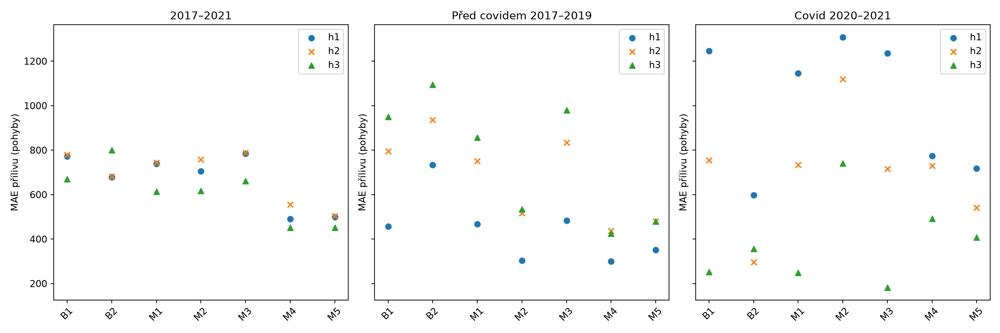
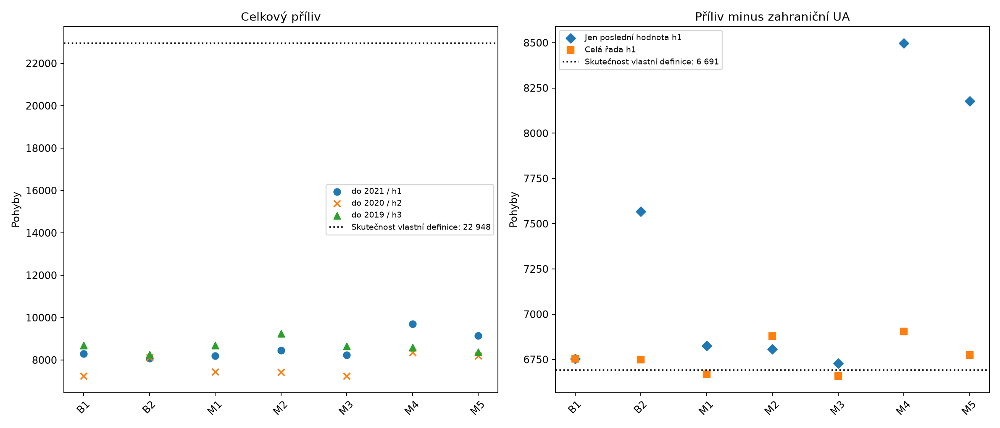

# Bonus: vynechání roku 2021 a odečet zahraničního přílivu občanů Ukrajiny

Doplněk vznikl po znalosti výsledku 2022. Původní zmrazené analýzy a závěry se nemění. Primární veličinou je přistěhování přes hranici Ústeckého kraje. Všechny modelové rodiny a obě reference zůstávají viditelné; podle shody s rokem 2022 se nevybírá vítěz.

Doporučení: rok 2021 z hlavní predikce automaticky nevynechávat. Pokud otázka výslovně míří na příliv bez zahraniční složky občanů Ukrajiny, použít konzistentní definici ve všech ověřených letech 2006–2021 a srovnat se stejně definovaným cílem; ani tato úprava nepomáhá každému modelu. Běžná předválečná UA migrace je oprávněnou součástí celkového přílivu. Pro celkový scénář bez války by bylo třeba tuto běžnou složku modelovat samostatně a přičíst, včetně její nejistoty; Samotný odečet proto nereprezentuje svět bez války; ani samostatné modelování běžné UA složky by samo o sobě takový kontrafaktuál neidentifikovalo.

Modely: B1 poslední hodnota; B2 průměr posledních tří let; M1 Holt; M2 ARIMA; M3 Theta; M4 Ridge; M5 Poisson.

## Vynechání posledních let současně prodlužuje horizont

Pevné konfigurace byly zvoleny na vývojových cílech do roku 2014. Shodné historické cíle 2017–2021 hodnotíme pro h1 (historie do t−1), h2 (do t−2) a h3 (do t−3). Vícekrokové odhady nedostávají skutečné mezilehlé výsledky. Rozdíl horizontů zároveň mění stáří informací i poslední dostupný rok; nejde o izolovaný efekt roku 2021, covidu či sčítání. Pět cílů a tři předcovidové cíle neposkytují silný statistický důkaz.

Ve všech sedmi modelech je historická MAE h2 na stejných pěti cílech horší než h1. Výsledky h3 jsou smíšené a případné zlepšení vzniká na covidových cílech: na předcovidových cílech 2017–2019 jsou všechny delší horizonty u všech modelů horší než h1. Vynechání roku 2021 tedy nemá oporu jako obecné zlepšení metody.

| Model | MAE h1 | MAE h2 | MAE h3 | Zlepšení h2 proti h1 | Zlepšení h3 proti h1 |
| --- | --- | --- | --- | --- | --- |
| B1 | 772,60 | 779,20 | 670,60 | -0,85 % | 13,20 % |
| B2 | 679,60 | 680,60 | 799,60 | -0,15 % | -17,66 % |
| M1 | 737,96 | 744,42 | 613,39 | -0,88 % | 16,88 % |
| M2 | 704,44 | 758,01 | 616,85 | -7,60 % | 12,43 % |
| M3 | 783,99 | 787,23 | 661,03 | -0,41 % | 15,68 % |
| M4 | 490,17 | 554,85 | 451,61 | -13,20 % | 7,87 % |
| M5 | 498,34 | 504,21 | 451,56 | -1,18 % | 9,39 % |

Sloupce zlepšení jsou 1 − MAE delšího horizontu / MAE h1; záporné hodnoty znamenají zhoršení. [Podrobné MAE/RMSE/podepsané chyby pro všechna tři období](../../results/migration_2022/bonus_2021/total_historical_metrics.csv) a [párová porovnání včetně jednotlivých roků](../../results/migration_2022/bonus_2021/total_paired_horizon_comparison.csv).

[SVG](bonus_2021/historical_horizons.svg)

## Co znamená odečet zahraniční UA složky

Ověřený zahraniční příliv občanů Ukrajiny do kraje v roce 2021 činí 1 552 (ČSÚ, roční tabulka, buňka C53). Celkových 8 305 minus 1 552 dává 6 753. Konečná stejně upravená skutečnost 2022 činí 22 948 minus 16 257 = 6 691. Předběžný příliv bez DO 7 405 má jinou definici. Občanství, země předchozího pobytu a dočasná ochrana nejsou totéž. Odečet zahraniční UA složky ponechává domácí stěhování občanů Ukrajiny i jiné přímé či nepřímé válečné vlivy.

Konzistentní řada odečítá stejnou zahraniční UA složku v každém trénovacím i cílovém roce. Jednorázová změna poslední hodnoty je samostatná citlivost, nikoli oprava chybné statistiky. Kontrolní celková řada na stejném kratším okně odděluje vliv změněné historie od vlivu odečtu. Původní konfigurace se znovu neladí.

Ověřená souvislá historie zahraničního UA přílivu pokrývá 2006–2021. Roky 2000–2005 nebyly ověřeny a nebyly imputovány. Celkové toky všech 16 zdrojových roků přesně souhlasí se zmrazenou krajskou řadou, ale předběžná verze složek občanství nevylučuje dílčí revize. [Pokrytí zdrojů](../../results/migration_2022/bonus_2021/source_coverage_2000_2021.csv) a [ověřená historie](../../results/migration_2022/bonus_2021/verified_history.csv).

## Rok 2022: pět hlavních variant a všech sedm modelů

První tři varianty jsou původní celkový příliv s horizonty h1/h2/h3; čtvrtá mění pouze poslední pozorování; pátá důsledně transformuje celou ověřenou řadu. Každá tabulka uvádí odpovídající skutečnost své vlastní definice.

### Celkový příliv, historie 2000–2021 (h1)

| Model | Odhad 2022 | Skutečnost 2022 | Relativní odchylka 2022 | Historická MAE | Počet cílů | Historické zlepšení proti B1 | Historické zlepšení proti B2 | Zlepšení odchylky 2022 proti B1 | Zlepšení odchylky 2022 proti B2 |
| --- | --- | --- | --- | --- | --- | --- | --- | --- | --- |
| B1 | 8 305,00 | 22 948,00 | -63,81 % | 772,60 | 5 | 0,00 % | -13,68 % | 0,00 % | 1,48 % |
| B2 | 8 085,33 | 22 948,00 | -64,77 % | 679,60 | 5 | 12,04 % | 0,00 % | -1,50 % | 0,00 % |
| M1 | 8 189,30 | 22 948,00 | -64,31 % | 737,96 | 5 | 4,48 % | -8,59 % | -0,79 % | 0,70 % |
| M2 | 8 459,10 | 22 948,00 | -63,14 % | 704,44 | 5 | 8,82 % | -3,66 % | 1,05 % | 2,51 % |
| M3 | 8 241,64 | 22 948,00 | -64,09 % | 783,99 | 5 | -1,47 % | -15,36 % | -0,43 % | 1,05 % |
| M4 | 9 709,89 | 22 948,00 | -57,69 % | 490,17 | 5 | 36,56 % | 27,87 % | 9,59 % | 10,93 % |
| M5 | 9 143,62 | 22 948,00 | -60,16 % | 498,34 | 5 | 35,50 % | 26,67 % | 5,73 % | 7,12 % |

### Celkový příliv, historie 2000–2020 (h2)

| Model | Odhad 2022 | Skutečnost 2022 | Relativní odchylka 2022 | Historická MAE | Počet cílů | Historické zlepšení proti B1 | Historické zlepšení proti B2 | Zlepšení odchylky 2022 proti B1 | Zlepšení odchylky 2022 proti B2 |
| --- | --- | --- | --- | --- | --- | --- | --- | --- | --- |
| B1 | 7 255,00 | 22 948,00 | -68,39 % | 779,20 | 5 | 0,00 % | -14,49 % | 0,00 % | -5,75 % |
| B2 | 8 108,00 | 22 948,00 | -64,67 % | 680,60 | 5 | 12,65 % | 0,00 % | 5,44 % | 0,00 % |
| M1 | 7 446,19 | 22 948,00 | -67,55 % | 744,42 | 5 | 4,46 % | -9,38 % | 1,22 % | -4,46 % |
| M2 | 7 418,09 | 22 948,00 | -67,67 % | 758,01 | 5 | 2,72 % | -11,37 % | 1,04 % | -4,65 % |
| M3 | 7 238,13 | 22 948,00 | -68,46 % | 787,23 | 5 | -1,03 % | -15,67 % | -0,11 % | -5,86 % |
| M4 | 8 345,06 | 22 948,00 | -63,63 % | 554,85 | 5 | 28,79 % | 18,48 % | 6,95 % | 1,60 % |
| M5 | 8 191,57 | 22 948,00 | -64,30 % | 504,21 | 5 | 35,29 % | 25,92 % | 5,97 % | 0,56 % |

### Celkový příliv, historie 2000–2019 (h3)

| Model | Odhad 2022 | Skutečnost 2022 | Relativní odchylka 2022 | Historická MAE | Počet cílů | Historické zlepšení proti B1 | Historické zlepšení proti B2 | Zlepšení odchylky 2022 proti B1 | Zlepšení odchylky 2022 proti B2 |
| --- | --- | --- | --- | --- | --- | --- | --- | --- | --- |
| B1 | 8 696,00 | 22 948,00 | -62,11 % | 670,60 | 5 | 0,00 % | 16,13 % | 0,00 % | 3,01 % |
| B2 | 8 253,33 | 22 948,00 | -64,03 % | 799,60 | 5 | -19,24 % | 0,00 % | -3,11 % | 0,00 % |
| M1 | 8 700,46 | 22 948,00 | -62,09 % | 613,39 | 5 | 8,53 % | 23,29 % | 0,03 % | 3,04 % |
| M2 | 9 246,93 | 22 948,00 | -59,70 % | 616,85 | 5 | 8,02 % | 22,86 % | 3,87 % | 6,76 % |
| M3 | 8 651,76 | 22 948,00 | -62,30 % | 661,03 | 5 | 1,43 % | 17,33 % | -0,31 % | 2,71 % |
| M4 | 8 601,33 | 22 948,00 | -62,52 % | 451,61 | 5 | 32,66 % | 43,52 % | -0,66 % | 2,37 % |
| M5 | 8 368,00 | 22 948,00 | -63,53 % | 451,56 | 5 | 32,66 % | 43,53 % | -2,30 % | 0,78 % |

### Odečet pouze poslední hodnoty, plná historie (h1)

| Model | Odhad 2022 | Skutečnost 2022 | Relativní odchylka 2022 | Historická MAE | Počet cílů | Historické zlepšení proti B1 | Historické zlepšení proti B2 | Zlepšení odchylky 2022 proti B1 | Zlepšení odchylky 2022 proti B2 |
| --- | --- | --- | --- | --- | --- | --- | --- | --- | --- |
| B1 | 6 753,00 | 6 691,00 | 0,93 % | 416,40 | 5 | 0,00 % | 31,32 % | 0,00 % | 92,93 % |
| B2 | 7 568,00 | 6 691,00 | 13,11 % | 606,33 | 5 | -45,61 % | 0,00 % | -1 314,52 % | 0,00 % |
| M1 | 6 825,07 | 6 691,00 | 2,00 % | 386,21 | 5 | 7,25 % | 36,30 % | -116,23 % | 84,71 % |
| M2 | 6 806,25 | 6 691,00 | 1,72 % | 457,03 | 5 | -9,76 % | 24,62 % | -85,89 % | 86,86 % |
| M3 | 6 728,66 | 6 691,00 | 0,56 % | 414,75 | 5 | 0,40 % | 31,60 % | 39,26 % | 95,71 % |
| M4 | 8 496,99 | 6 691,00 | 26,99 % | 742,12 | 5 | -78,22 % | -22,39 % | -2 812,89 % | -105,93 % |
| M5 | 8 178,48 | 6 691,00 | 22,23 % | 760,24 | 5 | -82,57 % | -25,38 % | -2 299,17 % | -69,61 % |

### Odečet zahraniční UA ve všech letech (h1)

| Model | Odhad 2022 | Skutečnost 2022 | Relativní odchylka 2022 | Historická MAE | Počet cílů | Historické zlepšení proti B1 | Historické zlepšení proti B2 | Zlepšení odchylky 2022 proti B1 | Zlepšení odchylky 2022 proti B2 |
| --- | --- | --- | --- | --- | --- | --- | --- | --- | --- |
| B1 | 6 753,00 | 6 691,00 | 0,93 % | 416,40 | 5 | 0,00 % | -26,28 % | 0,00 % | -8,14 % |
| B2 | 6 748,33 | 6 691,00 | 0,86 % | 329,73 | 5 | 20,81 % | 0,00 % | 7,53 % | 0,00 % |
| M1 | 6 666,92 | 6 691,00 | -0,36 % | 490,94 | 5 | -17,90 % | -48,89 % | 61,16 % | 58,00 % |
| M2 | 6 878,80 | 6 691,00 | 2,81 % | 544,30 | 5 | -30,72 % | -65,07 % | -202,90 % | -227,56 % |
| M3 | 6 657,86 | 6 691,00 | -0,50 % | 979,47 | 5 | -135,22 % | -197,05 % | 46,56 % | 42,21 % |
| M4 | 6 904,25 | 6 691,00 | 3,19 % | 320,59 | 5 | 23,01 % | 2,77 % | -243,95 % | -271,94 % |
| M5 | 6 775,06 | 6 691,00 | 1,26 % | 325,58 | 5 | 21,81 % | 1,26 % | -35,58 % | -46,62 % |

Relativní odchylka znamená (odhad − srovnávaná skutečnost) / skutečnost; není identifikovanou chybou světa bez války. Historické zlepšení proti B1/B2 patří vždy ke stejné variantě, horizontu a definici cíle. Zlepšení odchylky 2022 je 1 − absolutní odchylka modelu / absolutní odchylka odpovídající reference.

B1 po úpravě pouze poslední hodnoty i po konzistentní transformaci historie dává shodně 6 753 z definice modelu poslední hodnoty. Jeho přibližně 0,93% odchylka od 6 691 proto nedokazuje výhodu transformace celé historie. U celkové migrace je v roce 2022 h2 horší než h1 u šesti ze sedmi modelů; mírnou výjimkou je B2. Proti jinému cíli, předběžnému přílivu bez DO 7 405, může B1 h2 = 7 255 působit blíže než h1 = 8 305; změna cíle ale neověřuje správnost kontrafaktuálu.

[SVG](bonus_2021/all_primary_2022.svg)

## Historické ověření upraveného cíle a vliv okna

Níže jsou h1 výsledky na shodně upraveném cíli a stejných pěti letech. Kontrolní matched_total ponechává celkové vstupy, ale hodnotí je zde proti upravenému cíli. Nejde o přirozený cíl tohoto modelu; samostatné přirozené celkové hodnocení je v CSV.

### Odečet pouze poslední hodnoty, plná historie

| Model | Počet cílů | MAE | RMSE | Historické zlepšení proti B1 | Historické zlepšení proti B2 |
| --- | --- | --- | --- | --- | --- |
| B1 | 5 | 416,40 | 567,53 | 0,00 % | 31,32 % |
| B2 | 5 | 606,33 | 848,07 | -45,61 % | 0,00 % |
| M1 | 5 | 386,21 | 580,14 | 7,25 % | 36,30 % |
| M2 | 5 | 457,03 | 603,38 | -9,76 % | 24,62 % |
| M3 | 5 | 414,75 | 564,13 | 0,40 % | 31,60 % |
| M4 | 5 | 742,12 | 871,90 | -78,22 % | -22,39 % |
| M5 | 5 | 760,24 | 897,12 | -82,57 % | -25,38 % |

### Odečet zahraniční UA ve všech letech

| Model | Počet cílů | MAE | RMSE | Historické zlepšení proti B1 | Historické zlepšení proti B2 |
| --- | --- | --- | --- | --- | --- |
| B1 | 5 | 416,40 | 567,53 | 0,00 % | -26,28 % |
| B2 | 5 | 329,73 | 513,69 | 20,81 % | 0,00 % |
| M1 | 5 | 490,94 | 541,32 | -17,90 % | -48,89 % |
| M2 | 5 | 544,30 | 688,24 | -30,72 % | -65,07 % |
| M3 | 5 | 979,47 | 997,73 | -135,22 % | -197,05 % |
| M4 | 5 | 320,59 | 526,54 | 23,01 % | 2,77 % |
| M5 | 5 | 325,58 | 513,05 | 21,81 % | 1,26 % |

### Celkový příliv, stejná kratší historie

| Model | Počet cílů | MAE | RMSE | Historické zlepšení proti B1 | Historické zlepšení proti B2 |
| --- | --- | --- | --- | --- | --- |
| B1 | 5 | 903,80 | 1 245,49 | 0,00 % | -10,26 % |
| B2 | 5 | 819,73 | 1 125,93 | 9,30 % | 0,00 % |
| M1 | 5 | 439,64 | 490,08 | 51,36 % | 46,37 % |
| M2 | 5 | 868,59 | 1 270,31 | 3,90 % | -5,96 % |
| M3 | 5 | 765,81 | 1 072,45 | 15,27 % | 6,58 % |
| M4 | 5 | 880,67 | 1 169,20 | 2,56 % | -7,43 % |
| M5 | 5 | 843,05 | 1 133,98 | 6,72 % | -2,84 % |

### Odečet pouze poslední hodnoty, stejná kratší historie

| Model | Počet cílů | MAE | RMSE | Historické zlepšení proti B1 | Historické zlepšení proti B2 |
| --- | --- | --- | --- | --- | --- |
| B1 | 5 | 416,40 | 567,53 | 0,00 % | 31,32 % |
| B2 | 5 | 606,33 | 848,07 | -45,61 % | 0,00 % |
| M1 | 5 | 422,61 | 498,69 | -1,49 % | 30,30 % |
| M2 | 5 | 616,66 | 791,09 | -48,09 % | -1,70 % |
| M3 | 5 | 460,06 | 575,05 | -10,49 % | 24,12 % |
| M4 | 5 | 571,56 | 791,78 | -37,26 % | 5,73 % |
| M5 | 5 | 543,45 | 759,58 | -30,51 % | 10,37 % |

Konzistentní definice je metodicky srozumitelnější pro odhad upravené veličiny, ale nepřináší zlepšení každé rodině. Například M4 a M5 mají nižší historickou MAE než kontrola celkových vstupů na stejném okně; M1 a M3 takové plošné zlepšení nemají. Model je třeba posuzovat podle historických výsledků a malého počtu cílů, nikoli vyhlásit vítěze podle 2022.

[Kompletní evaluace všech 77 výsledků](../../results/migration_2022/bonus_2021/evaluation_2022.csv) zahrnuje i matched_total a terminal_clean_matched_h1 a vícekrokové kontrolní varianty. [Úplné historické metriky transformací](../../results/migration_2022/bonus_2021/clean_model_comparison.csv) oddělují všechny horizonty, období a cíle; [párové rozdíly horizontů](../../results/migration_2022/bonus_2021/total_paired_horizon_comparison.csv) zachovávají jednotlivé testovací roky.

## Diagnostika populačního vstupu

| Model | Původní odhad | Zátěžový odhad | Změna odhadu | Relativní změna |
| --- | --- | --- | --- | --- |
| M4 | 9 709,89 | 8 476,25 | -1 233,64 | -12,71 % |
| M5 | 9 143,62 | 8 308,95 | -834,67 | -9,13 % |

Pouze populace 2021 byla nahrazena pozorovanou populací 2020; koeficienty zůstaly shodné. U M4 se odhad změnil z 9 709,89 na 8 476,25, u M5 z 9 143,62 na 8 308,95. Jde o zátěžový test mechanismu vstupu, nikoli opravenou populaci, opravenou předpověď nebo důkaz vyšší přesnosti. Citlivost na populační příznak sčítání nedává důvod odstranit migrační tok roku 2021 jako metodickou opravu.

Ověření: [bonusová validace](../../logs/migration_2022/bonus_2021/validation.json) pokrývá 385 historických a 77 finálních výsledků; shoda SHA-256 potvrzuje nezměněných 103 původních souborů.

## Metodická interpretace

Zlom populačního stavu při sčítání 2021 sám nedokládá chybný roční příliv; migraci neodvozujeme rozdílem stavů. ČSÚ popisuje v letech 2020–2021 administrativní aktualizace evidence zejména u zahraničních odchodů. Tento poznatek není důkazem umělého navýšení přílivu 2021. Lepší shoda jednotlivého modelu s upraveným rokem 2022 neprokazuje vyšší schopnost odhadovat nepozorovaný vývoj bez války.

[Hlavní výsledky](RESULTS.md) · [Metodika](METHODOLOGY.md) · [Bonusová data](../../results/migration_2022/bonus_2021/)

Lokální reprodukce používá Python `/Users/hugo/Documents/ChatGPT/Děčín Heckathon/migration_2022_local/venv/bin/python` a skripty v `/Users/hugo/Documents/ChatGPT/Děčín Heckathon/migration_2022_local/bonus_2021/`. Nejprve `assemble_sources.py` nad dochovanými lokálními zdrojovými soubory; další běh provádět v nové pracovní kopii, aby se nepřepisovaly zmrazené audity. Po již uložené konfiguraci: `total_models/run_bonus_total.py`; `clean_models/run_clean.py --input '/Users/hugo/Documents/ChatGPT/Děčín Heckathon/migration_2022_local/bonus_2021/verified_history.csv' --clean-start 2006 --source-manifest '/Users/hugo/Documents/ChatGPT/Děčín Heckathon/migration_2022_local/bonus_2021/source_manifest.json'`; po zmrazení `population_diagnostic/run_diagnostic.py` a `evaluate_bonus.py`; následně `report/build_bonus_report.py` a `validate_bonus.py --clean-input '/Users/hugo/Documents/ChatGPT/Děčín Heckathon/migration_2022_local/bonus_2021/verified_history.csv'`. Každý relativně uvedený skript leží v uvedeném úplném bonusovém kořeni a spouští se uvedeným Pythonem. Přesná konfigurace je v [clean_protocol.json](../../logs/migration_2022/bonus_2021/clean_protocol.json) a [total_settings.json](../../logs/migration_2022/bonus_2021/total_settings.json); hashe zdrojů v [source_manifest.json](../../logs/migration_2022/bonus_2021/source_manifest.json). Trénovací kód zůstává lokálně; veřejné výsledky samotné neumožňují plnou reprodukci bez lokálního kódu.

Primární opory: [ČSÚ počet obyvatel — metodika](https://csu.gov.cz/pocet_obyvatel_m), [ČSÚ migrace krajů 2021, poznámky k administrativním odchodům](https://csu.gov.cz/docs/107508/a7944e29-d7b2-19f9-df3a-9f3e99500e7a/1301572206.pdf), [roční tabulka občanství 2021](https://csu.gov.cz/docs/107508/50f7f367-3839-1324-aaf8-19e1c7c31e5e/13006221q463.xlsx?version=1.0). Přesné zdrojové buňky, verze a hashe poskytují zveřejněné bonusové provenance a logy.
