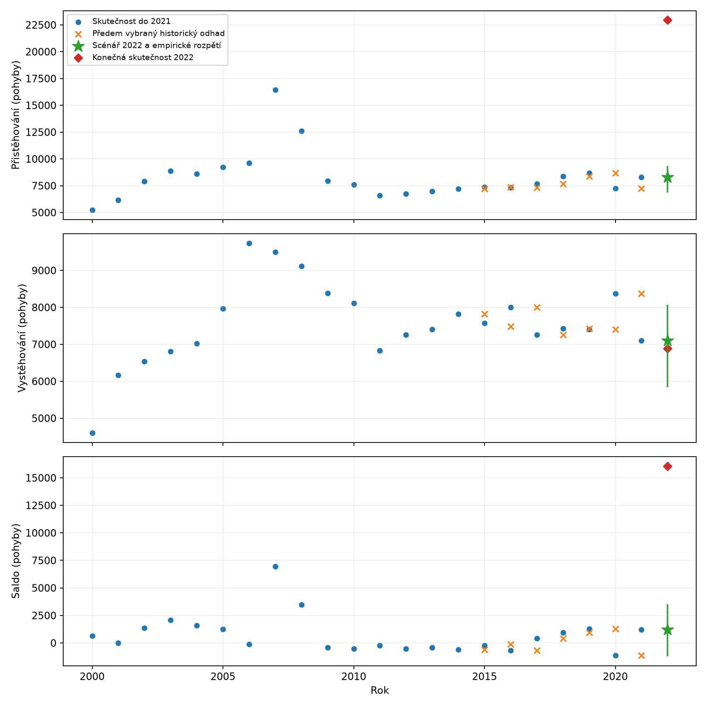
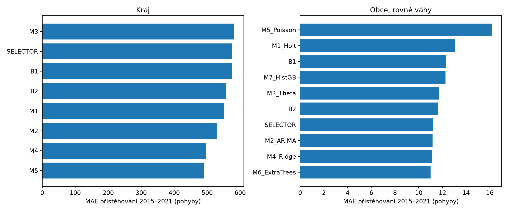
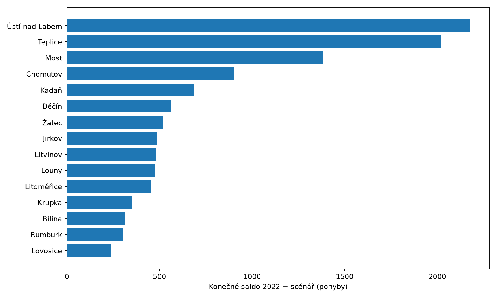
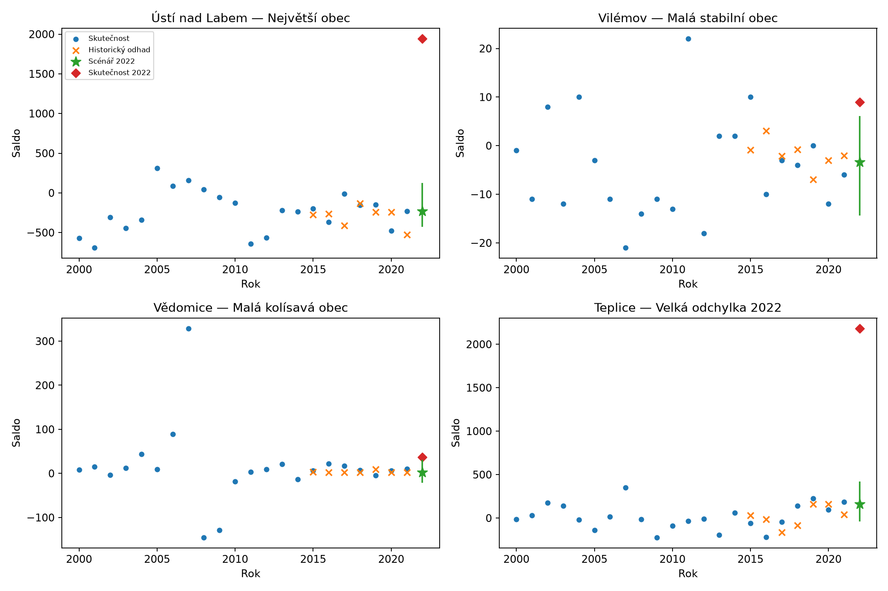
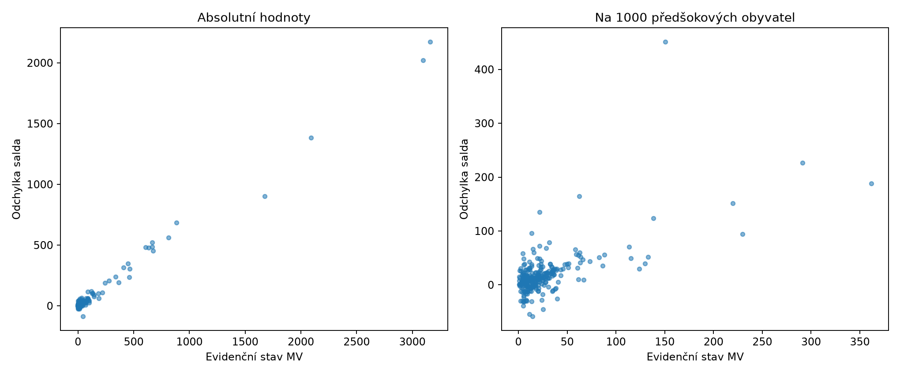

# Odhad migrace roku 2022 při pokračování předchozího vývoje

Jde o zpětný statistický scénář s historií 2000–2021 a horizontem jednoho roku. Odchylka konečné skutečnosti roku 2022 od scénáře není identifikovaným účinkem války ani chybou pozorovatelného kontrafaktuálu. Modely a konfigurace byly zmrazeny před výsledkovým porovnáním. Použity jsou zpětně dostupné datové verze, nikoli doložená prognóza publikovaná na konci roku 2021.

Historické hodnocení nepodporuje obecné tvrzení, že složitější modely překonávají reference. Krajský selektor v letech 2015–2021 nedosáhl nižší MAE než obě reference: I 575,14, E 560,19, saldo 1 087,62; B2 dosáhla 558,57 / 429,67 / 925,38. Pro rok 2022 zvolil krajský postup B1 pro oba proudy. Obecní selektor přinesl proti B2 pouze malé zlepšení: MAE I 11,18 proti 11,62, E 9,07 proti 9,29 a saldo 14,25 proti 14,33 při rovné váze obcí. Kandidátní vítězové nejsou nezávisle ověřenou přesností výběrového postupu.

## Kraj: scénář a dvě různá srovnání

| Ukazatel | Model | Odhad | Minimum scénářů | Maximum scénářů | Konečná skutečnost | Odchylka od odhadu | Předběžný benchmark bez DO | Benchmark bez DO − odhad |
| --- | --- | --- | --- | --- | --- | --- | --- | --- |
| Příchody | B1 | 8 305,00 | 6 873,13 | 9 354,97 | 22 948,00 | 14 643,00 | 7 405,00 | -900,00 |
| Odchody | B1 | 7 104,00 | 5 841,66 | 8 070,21 | 6 887,00 | -217,00 | 6 887,00 | -217,00 |
| Saldo | Rozdíl I − E | 1 201,00 | -1 197,08 | 3 513,31 | 16 061,00 | 14 860,00 | 518,00 | -683,00 |

Rozpětí je minimum a maximum sedmi společných ročních scénářů historických chyb 2015–2021; není to kalibrovaný 95% interval. Bodový odhad může ležet mimo empirické rozpětí, pokud mají všechny historické reziduální scénáře stejné znaménko. Předběžný benchmark bez dočasné ochrany (DO) vylučuje DO, ale zahrnuje jiné migranty z Ukrajiny, možné nepřímé dopady a odlišnou datovou revizi. Nepředstavuje skutečný svět bez války. Krajské I/E jsou toky přes hranici kraje. Součty obecních I/E mají jinou definici.

[SVG](figures/regional_history.svg)

## Historické ověření předem vybíraného postupu

Tabulka ukazuje skutečný postup výběru vždy pouze podle předchozích let a obě reference; skóre kandidátů samo není nezávislou přesností selektoru.

| Úroveň | Ukazatel | Model | Počet území | Počet testovacích let | MAE | RMSE | Podepsaná chyba | MASE | Zlepšení proti B1 | Zlepšení proti B2 |
| --- | --- | --- | --- | --- | --- | --- | --- | --- | --- | --- |
| Obce | Saldo | B1 | 354 | 7 | 17,12 | 33,39 | -0,72 | — | 0,00 % | -19,40 % |
| Obce | Saldo | B2 | 354 | 7 | 14,33 | 29,41 | -0,78 | — | 16,25 % | 0,00 % |
| Obce | Saldo | Selektor | 354 | 7 | 14,25 | 28,66 | -1,53 | — | 16,73 % | 0,57 % |
| Obce | Příchody | B1 | 354 | 7 | 12,33 | 25,30 | 0,75 | 0,94 | 0,00 % | -6,13 % |
| Obce | Příchody | B2 | 354 | 7 | 11,62 | 26,27 | 1,43 | 0,82 | 5,78 % | 0,00 % |
| Obce | Příchody | Selektor | 354 | 7 | 11,18 | 24,43 | 0,74 | 0,81 | 9,27 % | 3,71 % |
| Obce | Odchody | B1 | 354 | 7 | 10,62 | 21,13 | 1,48 | 1,05 | 0,00 % | -14,31 % |
| Obce | Odchody | B2 | 354 | 7 | 9,29 | 18,66 | 2,21 | 0,89 | 12,52 % | 0,00 % |
| Obce | Odchody | Selektor | 354 | 7 | 9,07 | 18,54 | 2,27 | 0,87 | 14,64 % | 2,42 % |
| Kraj | Saldo | B1 | 1 | 7 | 1 074,14 | 1 368,65 | -256,43 | — | 0,00 % | -16,08 % |
| Kraj | Saldo | B2 | 1 | 7 | 925,38 | 1 072,89 | -277,00 | — | 13,85 % | 0,00 % |
| Kraj | Saldo | Selektor | 1 | 7 | 1 087,62 | 1 373,60 | -242,95 | — | -1,25 % | -17,53 % |
| Kraj | Příchody | B1 | 1 | 7 | 575,14 | 746,51 | -153,71 | 0,44 | 0,00 % | -2,97 % |
| Kraj | Příchody | B2 | 1 | 7 | 558,57 | 653,93 | -273,33 | 0,42 | 2,88 % | 0,00 % |
| Kraj | Příchody | Selektor | 1 | 7 | 575,14 | 746,51 | -153,71 | 0,44 | 0,00 % | -2,97 % |
| Kraj | Odchody | B1 | 1 | 7 | 546,71 | 692,03 | 102,71 | 0,93 | 0,00 % | -27,24 % |
| Kraj | Odchody | B2 | 1 | 7 | 429,67 | 525,38 | 3,67 | 0,73 | 21,41 % | 0,00 % |
| Kraj | Odchody | Selektor | 1 | 7 | 560,19 | 701,12 | 89,24 | 0,95 | -2,47 % | -30,38 % |

Všechny rodiny na stejném pokrytí (chyby zahrnují označený náhradní odhad při selhání):

| Úroveň | Ukazatel | Model | MAE | RMSE | Řádky s náhradou | Úspěšné roky: minimum | Úspěšné roky: maximum |
| --- | --- | --- | --- | --- | --- | --- | --- |
| Obce | Saldo | B1 | 17,12 | 33,39 | 0 | 7 | 7 |
| Obce | Saldo | B2 | 14,33 | 29,41 | 0 | 7 | 7 |
| Obce | Saldo | M1_Holt | 15,62 | 33,95 | 2 | 6 | 7 |
| Obce | Saldo | M2_ARIMA | 13,81 | 29,12 | 0 | 7 | 7 |
| Obce | Saldo | M3_Theta | 14,74 | 30,67 | 0 | 7 | 7 |
| Obce | Saldo | M4_Ridge | 13,65 | 28,51 | 0 | 7 | 7 |
| Obce | Saldo | M5_Poisson | 14,77 | 33,40 | 0 | 7 | 7 |
| Obce | Saldo | M6_ExtraTrees | 13,00 | 27,34 | 0 | 7 | 7 |
| Obce | Saldo | M7_HistGB | 14,12 | 32,62 | 0 | 7 | 7 |
| Obce | Saldo | Selektor | 14,25 | 28,66 | 0 | 7 | 7 |
| Obce | Příchody | B1 | 12,33 | 25,30 | 0 | 7 | 7 |
| Obce | Příchody | B2 | 11,62 | 26,27 | 0 | 7 | 7 |
| Obce | Příchody | M1_Holt | 13,06 | 30,06 | 0 | 7 | 7 |
| Obce | Příchody | M2_ARIMA | 11,17 | 24,29 | 0 | 7 | 7 |
| Obce | Příchody | M3_Theta | 11,69 | 26,03 | 0 | 7 | 7 |
| Obce | Příchody | M4_Ridge | 11,15 | 25,96 | 0 | 7 | 7 |
| Obce | Příchody | M5_Poisson | 16,19 | 47,99 | 0 | 7 | 7 |
| Obce | Příchody | M6_ExtraTrees | 11,00 | 23,66 | 0 | 7 | 7 |
| Obce | Příchody | M7_HistGB | 12,27 | 32,22 | 0 | 7 | 7 |
| Obce | Příchody | Selektor | 11,18 | 24,43 | 0 | 7 | 7 |
| Obce | Odchody | B1 | 10,62 | 21,13 | 0 | 7 | 7 |
| Obce | Odchody | B2 | 9,29 | 18,66 | 0 | 7 | 7 |
| Obce | Odchody | M1_Holt | 10,51 | 22,32 | 2 | 6 | 7 |
| Obce | Odchody | M2_ARIMA | 9,45 | 20,87 | 0 | 7 | 7 |
| Obce | Odchody | M3_Theta | 9,51 | 19,29 | 0 | 7 | 7 |
| Obce | Odchody | M4_Ridge | 8,87 | 17,73 | 0 | 7 | 7 |
| Obce | Odchody | M5_Poisson | 12,44 | 35,25 | 0 | 7 | 7 |
| Obce | Odchody | M6_ExtraTrees | 8,93 | 19,51 | 0 | 7 | 7 |
| Obce | Odchody | M7_HistGB | 10,08 | 27,14 | 0 | 7 | 7 |
| Obce | Odchody | Selektor | 9,07 | 18,54 | 0 | 7 | 7 |
| Kraj | Saldo | B1 | 1 074,14 | 1 368,65 | 0 | 7 | 7 |
| Kraj | Saldo | B2 | 925,38 | 1 072,89 | 0 | 7 | 7 |
| Kraj | Saldo | M1 | 1 060,25 | 1 323,75 | 0 | 7 | 7 |
| Kraj | Saldo | M2 | 967,95 | 1 345,43 | 0 | 7 | 7 |
| Kraj | Saldo | M3 | 1 099,95 | 1 378,73 | 0 | 7 | 7 |
| Kraj | Saldo | M4 | 981,71 | 1 167,53 | 0 | 7 | 7 |
| Kraj | Saldo | M5 | 843,76 | 1 011,28 | 0 | 7 | 7 |
| Kraj | Saldo | Selektor | 1 087,62 | 1 373,60 | 0 | 7 | 7 |
| Kraj | Příchody | B1 | 575,14 | 746,51 | 0 | 7 | 7 |
| Kraj | Příchody | B2 | 558,57 | 653,93 | 0 | 7 | 7 |
| Kraj | Příchody | M1 | 550,49 | 709,32 | 0 | 7 | 7 |
| Kraj | Příchody | M2 | 530,64 | 757,02 | 0 | 7 | 7 |
| Kraj | Příchody | M3 | 581,65 | 748,58 | 0 | 7 | 7 |
| Kraj | Příchody | M4 | 497,00 | 622,19 | 0 | 7 | 7 |
| Kraj | Příchody | M5 | 489,73 | 585,00 | 0 | 7 | 7 |
| Kraj | Příchody | Selektor | 575,14 | 746,51 | 0 | 7 | 7 |
| Kraj | Odchody | B1 | 546,71 | 692,03 | 0 | 7 | 7 |
| Kraj | Odchody | B2 | 429,67 | 525,38 | 0 | 7 | 7 |
| Kraj | Odchody | M1 | 550,73 | 695,41 | 0 | 7 | 7 |
| Kraj | Odchody | M2 | 517,58 | 648,20 | 0 | 7 | 7 |
| Kraj | Odchody | M3 | 554,71 | 700,51 | 0 | 7 | 7 |
| Kraj | Odchody | M4 | 704,00 | 859,29 | 0 | 7 | 7 |
| Kraj | Odchody | M5 | 417,62 | 520,29 | 0 | 7 | 7 |
| Kraj | Odchody | Selektor | 560,19 | 701,12 | 0 | 7 | 7 |

[SVG](figures/model_mae.svg)

Podrobné rovné i objemové váhy, velikostní skupiny a rozdělení 2015–2019 / 2020–2021 jsou v [model_comparison.csv](../../results/migration_2022/model_comparison.csv). MASE se počítá jen pro nenulový historický jmenovatel.

## Doplňkové skutečné krajské údaje

| Definice | Příchody | Odchody | Saldo |
| --- | --- | --- | --- |
| Konečné: veškeré toky | 22 948,00 | 6 887,00 | 16 061,00 |
| Konečné: zahraniční | 17 735,00 | 976,00 | 16 759,00 |
| Konečné: mezikrajské | 5 213,00 | 5 911,00 | -698,00 |
| Konečné: zahraniční, občanství Ukrajiny | 16 257,00 | 314,00 | 15 943,00 |
| Předběžné: bez DO | 7 405,00 | 6 887,00 | 518,00 |

Zahraniční a mezikrajské toky a zahraniční migrace občanů Ukrajiny jsou samostatné popisné kontroly. Občanství Ukrajiny není totožné s dočasnou ochranou ani zemí předchozího pobytu. Tato krajská čísla nebyla přidělena obcím ani použita k výběru modelu.

## Územní soulad a ORP

Součet konečných obecních sald: 16061; krajské konečné saldo: 16061; rozdíl obecní součet minus kraj: 0. Rozdíl nebyl opraven rescalováním. Stav kontroly: `municipal_vs_region_net_reconciled`. ORP predikce jsou součty obecních sald, rozpětí vzniká součtem každého společného ročního scénáře před výpočtem minima/maxima.

| SO ORP | Odhad | Minimum scénářů | Maximum scénářů | Součet konečných obecních sald | Předběžný benchmark bez DO | Benchmark bez DO − odhad |
| --- | --- | --- | --- | --- | --- | --- |
| Bílina | -28,48 | -125,82 | 54,42 | 297,00 | -24,00 | 4,48 |
| Děčín | -195,28 | -412,81 | 26,60 | 655,00 | -84,00 | 111,28 |
| Chomutov | 56,17 | -198,69 | 302,78 | 1 677,00 | -51,00 | -107,17 |
| Kadaň | 47,46 | -194,65 | 420,03 | 1 201,00 | 73,00 | 25,54 |
| Litoměřice | -48,85 | -137,28 | 146,25 | 977,00 | -56,00 | -7,15 |
| Litvínov | -59,64 | -196,92 | 186,92 | 571,00 | 74,00 | 133,64 |
| Louny | 42,12 | -17,07 | 185,85 | 736,00 | 84,00 | 41,88 |
| Lovosice | 139,34 | 77,35 | 335,82 | 495,00 | 137,00 | -2,34 |
| Most | -104,46 | -267,55 | 103,17 | 1 303,00 | -127,00 | -22,54 |
| Podbořany | 45,14 | 31,98 | 158,65 | 263,00 | 71,00 | 25,86 |
| Roudnice nad Labem | 137,44 | 36,14 | 382,09 | 664,00 | 142,00 | 4,56 |
| Rumburk | 110,36 | -36,21 | 382,10 | 606,00 | 61,00 | -49,36 |
| Teplice | 574,43 | 382,93 | 1 128,25 | 3 305,00 | 305,00 | -269,43 |
| Ústí nad Labem | -84,51 | -305,42 | 382,83 | 2 315,00 | -188,00 | -103,49 |
| Varnsdorf | -75,20 | -113,24 | -29,37 | 200,00 | -4,00 | 71,20 |
| Žatec | 81,53 | -39,81 | 200,58 | 796,00 | 105,00 | 23,47 |

## Selhání a použité modely

| Úroveň | Model | Stav výpočtu | Počet řádků |
| --- | --- | --- | --- |
| Obce | B1 | Úspěch | 4956 |
| Obce | B2 | Úspěch | 4956 |
| Obce | M1_Holt | Náhrada B1 | 2 |
| Obce | M1_Holt | Úspěch | 4954 |
| Obce | M2_ARIMA | Úspěch | 4956 |
| Obce | M3_Theta | Úspěch | 4956 |
| Obce | M4_Ridge | Úspěch | 4956 |
| Obce | M5_Poisson | Úspěch | 4956 |
| Obce | M6_ExtraTrees | Úspěch | 4956 |
| Obce | M7_HistGB | Úspěch | 4956 |
| Kraj | B1 | Úspěch | 14 |
| Kraj | B2 | Úspěch | 14 |
| Kraj | M1 | Úspěch | 14 |
| Kraj | M2 | Úspěch | 14 |
| Kraj | M3 | Úspěch | 14 |
| Kraj | M4 | Úspěch | 14 |
| Kraj | M5 | Úspěch | 14 |

Počet řádků není počet nezávislých fitů: společný panelový fit se může promítnout do mnoha obecních řádků. Podrobné důvody a varování obsahují fit logy.

| Ukazatel | Model | Počet obcí |
| --- | --- | --- |
| Příchody | B1 | 26 |
| Příchody | B2 | 214 |
| Příchody | M2_ARIMA | 26 |
| Příchody | M4_Ridge | 24 |
| Příchody | M5_Poisson | 39 |
| Příchody | M6_ExtraTrees | 10 |
| Příchody | M7_HistGB | 15 |
| Odchody | B1 | 6 |
| Odchody | B2 | 132 |
| Odchody | M1_Holt | 1 |
| Odchody | M2_ARIMA | 12 |
| Odchody | M4_Ridge | 38 |
| Odchody | M5_Poisson | 56 |
| Odchody | M6_ExtraTrees | 43 |
| Odchody | M7_HistGB | 66 |

## Nejistota a citlivost

| Úroveň | Ukazatel | Rok | Počet řádků | Počet uvnitř rozpětí | Pokrytí |
| --- | --- | --- | --- | --- | --- |
| Obce | Saldo | 2018 | 354 | 183 | 51,7 % |
| Obce | Saldo | 2019 | 354 | 218 | 61,6 % |
| Obce | Saldo | 2020 | 354 | 236 | 66,7 % |
| Obce | Saldo | 2021 | 354 | 254 | 71,8 % |
| Obce | Příchody | 2018 | 354 | 162 | 45,8 % |
| Obce | Příchody | 2019 | 354 | 208 | 58,8 % |
| Obce | Příchody | 2020 | 354 | 237 | 66,9 % |
| Obce | Příchody | 2021 | 354 | 250 | 70,6 % |
| Obce | Odchody | 2018 | 354 | 186 | 52,5 % |
| Obce | Odchody | 2019 | 354 | 211 | 59,6 % |
| Obce | Odchody | 2020 | 354 | 248 | 70,1 % |
| Obce | Odchody | 2021 | 354 | 252 | 71,2 % |
| Kraj | Saldo | 2018 | 1 | 1 | 100,0 % |
| Kraj | Saldo | 2019 | 1 | 1 | 100,0 % |
| Kraj | Saldo | 2020 | 1 | 0 | 0,0 % |
| Kraj | Saldo | 2021 | 1 | 0 | 0,0 % |
| Kraj | Příchody | 2018 | 1 | 0 | 0,0 % |
| Kraj | Příchody | 2019 | 1 | 1 | 100,0 % |
| Kraj | Příchody | 2020 | 1 | 0 | 0,0 % |
| Kraj | Příchody | 2021 | 1 | 0 | 0,0 % |
| Kraj | Odchody | 2018 | 1 | 1 | 100,0 % |
| Kraj | Odchody | 2019 | 1 | 1 | 100,0 % |
| Kraj | Odchody | 2020 | 1 | 0 | 0,0 % |
| Kraj | Odchody | 2021 | 1 | 0 | 0,0 % |

Historické pokrytí je prospektivní: pro testovaný rok jsou scénáře odvozeny pouze z dřívějších chyb. Počty nezávislých let jsou malé (3–6 předchozích roků); ani dobré obecní průměrné pokrytí negarantuje krajské nebo 95% pokrytí.

Citlivosti krajských kandidátů (stejné zmrazené konfigurace, bez výběru podle 2022):

| Ukazatel | Model | Varianta | Začátek historie | Konec historie | Odhad | Stav výpočtu |
| --- | --- | --- | --- | --- | --- | --- |
| Příchody | B1 | start_2001 | 2001 | 2021 | 8 305,00 | Úspěch |
| Příchody | B1 | recent_2010 | 2010 | 2021 | 8 305,00 | Úspěch |
| Příchody | B1 | pre_covid_2019_3step | 2000 | 2019 | 8 696,00 | Úspěch |
| Příchody | B2 | start_2001 | 2001 | 2021 | 8 085,33 | Úspěch |
| Příchody | B2 | recent_2010 | 2010 | 2021 | 8 085,33 | Úspěch |
| Příchody | B2 | pre_covid_2019_3step | 2000 | 2019 | 8 253,33 | Úspěch |
| Příchody | M1 | start_2001 | 2001 | 2021 | 8 193,07 | Úspěch |
| Příchody | M1 | recent_2010 | 2010 | 2021 | 7 927,41 | Úspěch |
| Příchody | M1 | pre_covid_2019_3step | 2000 | 2019 | 8 700,46 | Úspěch |
| Příchody | M2 | start_2001 | 2001 | 2021 | 8 446,60 | Úspěch |
| Příchody | M2 | recent_2010 | 2010 | 2021 | 7 979,50 | Úspěch |
| Příchody | M2 | pre_covid_2019_3step | 2000 | 2019 | 9 246,93 | Úspěch |
| Příchody | M3 | start_2001 | 2001 | 2021 | 8 178,38 | Úspěch |
| Příchody | M3 | recent_2010 | 2010 | 2021 | 8 170,95 | Úspěch |
| Příchody | M3 | pre_covid_2019_3step | 2000 | 2019 | 8 651,76 | Úspěch |
| Příchody | M4 | start_2001 | 2001 | 2021 | 9 886,58 | Úspěch |
| Příchody | M4 | recent_2010 | 2010 | 2021 | 9 140,80 | Úspěch |
| Příchody | M4 | pre_covid_2019_3step | 2000 | 2019 | 8 601,33 | Úspěch |
| Příchody | M5 | start_2001 | 2001 | 2021 | 9 308,89 | Úspěch |
| Příchody | M5 | recent_2010 | 2010 | 2021 | 9 138,23 | Úspěch |
| Příchody | M5 | pre_covid_2019_3step | 2000 | 2019 | 8 368,00 | Úspěch |
| Odchody | B1 | start_2001 | 2001 | 2021 | 7 104,00 | Úspěch |
| Odchody | B1 | recent_2010 | 2010 | 2021 | 7 104,00 | Úspěch |
| Odchody | B1 | pre_covid_2019_3step | 2000 | 2019 | 7 406,00 | Úspěch |
| Odchody | B2 | start_2001 | 2001 | 2021 | 7 626,67 | Úspěch |
| Odchody | B2 | recent_2010 | 2010 | 2021 | 7 626,67 | Úspěch |
| Odchody | B2 | pre_covid_2019_3step | 2000 | 2019 | 7 363,00 | Úspěch |
| Odchody | M1 | start_2001 | 2001 | 2021 | 7 173,45 | Úspěch |
| Odchody | M1 | recent_2010 | 2010 | 2021 | 7 572,67 | Úspěch |
| Odchody | M1 | pre_covid_2019_3step | 2000 | 2019 | 7 440,61 | Úspěch |
| Odchody | M2 | start_2001 | 2001 | 2021 | 7 225,73 | Úspěch |
| Odchody | M2 | recent_2010 | 2010 | 2021 | 7 716,61 | Úspěch |
| Odchody | M2 | pre_covid_2019_3step | 2000 | 2019 | 7 244,29 | Úspěch |
| Odchody | M3 | start_2001 | 2001 | 2021 | 7 108,62 | Úspěch |
| Odchody | M3 | recent_2010 | 2010 | 2021 | 7 591,98 | Úspěch |
| Odchody | M3 | pre_covid_2019_3step | 2000 | 2019 | 7 486,37 | Úspěch |
| Odchody | M4 | start_2001 | 2001 | 2021 | 7 289,03 | Úspěch |
| Odchody | M4 | recent_2010 | 2010 | 2021 | 7 226,45 | Úspěch |
| Odchody | M4 | pre_covid_2019_3step | 2000 | 2019 | 8 023,07 | Úspěch |
| Odchody | M5 | start_2001 | 2001 | 2021 | 7 579,98 | Úspěch |
| Odchody | M5 | recent_2010 | 2010 | 2021 | 7 457,32 | Úspěch |
| Odchody | M5 | pre_covid_2019_3step | 2000 | 2019 | 7 515,96 | Úspěch |

Lokální citlivost stejného vybraného modelu na souvislá okna 2001–2021 a 2010–2021:

| Citlivost | Ukazatel | Medián absolutní změny | Maximum absolutní změny |
| --- | --- | --- | --- |
| history_2001_2021 | Příchody | 0,00 | 2,34 |
| history_2001_2021 | Odchody | 0,07 | 3,25 |
| history_2010_2021 | Příchody | 0,00 | 13,04 |
| history_2010_2021 | Odchody | 0,10 | 24,07 |

Citlivost je změna scénáře při stejném zmrazeném modelu, nikoli ověřená lepší varianta.

Obecní citlivost bez covidových skutečností: fit do 2019 a skutečný tříkrokový rekurzivní odhad do 2022 s drženou populací 2019; mezera v kalendáři nebyla slepena. Všech 708 výsledných předpovědí má úspěšný stav výpočtu včetně referencí; nejde o 708 trénovaných fitů. Volba modelu a konfigurace zachovává informace do roku 2021: jde o citlivost finálně vybraného modelu, nikoli předpověď vydanou v roce 2019. Tyto varianty nebyly vybrány podle skutečnosti 2022.

| Citlivost | Ukazatel | Medián absolutní změny | Maximum absolutní změny |
| --- | --- | --- | --- |
| pre_covid_2019_3step | Příchody | 2,67 | 166,00 |
| pre_covid_2019_3step | Odchody | 1,78 | 166,91 |

## Obce a případové rozbory

Všech 354 obcí má [diagnostiku](../../results/migration_2022/municipality_diagnostics.csv) s velikostí před 2022, objemem, variabilitou, trendem, nulovými počty, délkou historie, územními příznaky a skutečnými historickými chybami selektoru. Model se vybírá samostatně pro každý proud. Geografie používá poslední obecní kódy; mapová geometrie není historickou rekonstrukcí.

[SVG](figures/municipal_deviations.svg)

Pravidlo případů: největší předšoková populace; nejnižší a nejvyšší variační koeficient součtu I+E mezi obcemi pod 1000 obyvatel s průměrným tokem alespoň 5; poté největší absolutní odchylka salda 2022 mimo předchozí obce. Poslední případ byl vybrán podle výsledku 2022 pouze pro popis, nikoli pro výběr modelu.

### Největší obec: Ústí nad Labem (554804)

Předšoková populace 90 951, průměrný roční součet pohybů 3 986,3, variační koeficient 0,10, lineární trend pohybů 21,88 za rok. Historická chyba předem vybíraného postupu pro saldo: MAE 175,0 z 7 roků; nulové toky I/E 0%/0%. Jde o popis řady a výkonnosti, nikoli vysvětlení příčin migrace. Počet roků s příznakem územní změny: 0, s příznakem účinnosti změny k 1. 1.: 0. Příznak není kvantifikací dopadu; obecní kódy jsou harmonizovány podle posledního přiřazení. Použitý model I/E: B1/B1; scénář salda -232,0, skutečnost 1 942, odchylka 2 174,0. Z těchto čísel nelze určit konkrétní sociální příčinu.

### Malá stabilní obec: Vilémov (562947)

Předšoková populace 877, průměrný roční součet pohybů 61,6, variační koeficient 0,16, lineární trend pohybů -0,46 za rok. Historická chyba předem vybíraného postupu pro saldo: MAE 6,9 z 7 roků; nulové toky I/E 0%/0%. Jde o popis řady a výkonnosti, nikoli vysvětlení příčin migrace. Počet roků s příznakem územní změny: 0, s příznakem účinnosti změny k 1. 1.: 0. Příznak není kvantifikací dopadu; obecní kódy jsou harmonizovány podle posledního přiřazení. Použitý model I/E: B2/M5_Poisson; scénář salda -3,3, skutečnost 9, odchylka 12,3. Z těchto čísel nelze určit konkrétní sociální příčinu.

### Malá kolísavá obec: Vědomice (565831)

Předšoková populace 885, průměrný roční součet pohybů 119,3, variační koeficient 1,33, lineární trend pohybů -4,79 za rok. Historická chyba předem vybíraného postupu pro saldo: MAE 9,4 z 7 roků; nulové toky I/E 0%/0%. Jde o popis řady a výkonnosti, nikoli vysvětlení příčin migrace. Počet roků s příznakem územní změny: 0, s příznakem účinnosti změny k 1. 1.: 0. Příznak není kvantifikací dopadu; obecní kódy jsou harmonizovány podle posledního přiřazení. Použitý model I/E: M5_Poisson/M5_Poisson; scénář salda 2,6, skutečnost 37, odchylka 34,4. Z těchto čísel nelze určit konkrétní sociální příčinu.

### Velká odchylka 2022: Teplice (567442)

Předšoková populace 48 846, průměrný roční součet pohybů 3 170,2, variační koeficient 0,08, lineární trend pohybů 5,07 za rok. Historická chyba předem vybíraného postupu pro saldo: MAE 130,5 z 7 roků; nulové toky I/E 0%/0%. Jde o popis řady a výkonnosti, nikoli vysvětlení příčin migrace. Počet roků s příznakem územní změny: 0, s příznakem účinnosti změny k 1. 1.: 0. Příznak není kvantifikací dopadu; obecní kódy jsou harmonizovány podle posledního přiřazení. Použitý model I/E: B1/M4_Ridge; scénář salda 161,4, skutečnost 2 183, odchylka 2 021,6. Z těchto čísel nelze určit konkrétní sociální příčinu.

[SVG](figures/case_histories.svg)

## Prostorová souvislost s evidenčním stavem MV

[SVG](figures/proxy_association.svg)

| Ukazatel | Měřítko | Metoda | Spárované obce | Chybějící MV stav | Korelace | Korelace po kontrole |
| --- | --- | --- | --- | --- | --- | --- |
| Příchody | Absolutní počty | Pearson | 273 | 81 | 0,99 | 0,99 |
| Příchody | Absolutní počty | Spearman | 273 | 81 | 0,66 | 0,53 |
| Příchody | Na 1000 předšokových obyvatel | Pearson | 273 | 81 | 0,70 | 0,69 |
| Příchody | Na 1000 předšokových obyvatel | Spearman | 273 | 81 | 0,55 | 0,56 |
| Saldo | Absolutní počty | Pearson | 273 | 81 | 0,99 | 0,99 |
| Saldo | Absolutní počty | Spearman | 273 | 81 | 0,65 | 0,44 |
| Saldo | Na 1000 předšokových obyvatel | Pearson | 273 | 81 | 0,65 | 0,64 |
| Saldo | Na 1000 předšokových obyvatel | Spearman | 273 | 81 | 0,49 | 0,49 |

MV je evidenční stav z publikovaného snapshotu 31. 12. 2022, bez tvrzení o konci dne; ČSÚ migrace je roční tok. Stav se od toku neodečítá. Pearson i Spearman a rezidualizace podle log populace a historického objemu jsou popisné prostorové asociace, nikoli test predikční chyby či kauzální důkaz. Chybějící MV záznam není nula. Definice a úplnost spojení viz [SOURCE_NOTES.md](SOURCE_NOTES.md).

## Co výsledek dovoluje říci

Lze odhadnout měřítko a proměnlivost pokračování historických migračních toků a porovnat s ním rok 2022. Krátká historie a selhání některých fitů omezují lokální přesnost, zejména u kolísavých malých obcí. Sedm hodnoticích let nedokládá přesnost 95% ocasů. Rozdíl celkové migrace a scénáře nerozkládá příčiny; bez srovnatelných obecních ročních toků DO nelze obecní rozdíly připsat uprchlíkům.

## Data, metodika a reprodukce

[Slovník dat](DATA_DICTIONARY.md), [metodika a konfigurace](METHODOLOGY.md), [primární zdroje a jejich definice](SOURCE_NOTES.md), [ČSÚ metodika](https://csu.gov.cz/pohyb-obyvatelstva-metodika), [časové testování FPP3](https://otexts.com/fpp3/toolbox.html). Kolem 2000/2001 se měnila metodika; od 2022 statistika zahrnuje stanovenou část DO. Sčítání 2001/2011/2021 a územní změny ovlivňují srovnatelnost.

Ověření dokončeno: [173 analytických kontrol](../../logs/migration_2022/validation.json) a [32 mapových testů](../../logs/migration_2022/map_regression_tests.txt). Ochrana původních souborů byla potvrzena shodou SHA-256.

Stručné příklady reprodukce (úplný seznam viz [METHODOLOGY.md](METHODOLOGY.md)) z lokálního kořene `/Users/hugo/Documents/ChatGPT/Děčín Heckathon/migration_2022_local`: `venv/bin/python region_models/run_region.py`, `venv/bin/python municipal_models/run.py`, `venv/bin/python selector/run_selector.py`; po zmrazení `venv/bin/python evaluation/integrate_evaluation.py`, `venv/bin/python publication.py evaluation`, `venv/bin/python report/build_report.py`. Modelovací kód je ponechán lokálně. Veřejné výsledky a hashe samy nezajišťují plnou reprodukovatelnost.

[Krajské výsledky](../../results/migration_2022/predictions_2022_region.csv) · [Obecní výsledky](../../results/migration_2022/predictions_2022_municipalities.csv) · [ORP benchmark](../../results/migration_2022/evaluation_2022_ORP.csv) · [Proxy porovnání](../../results/migration_2022/municipal_proxy_comparison.csv) · [Kontroly kvality](../../results/migration_2022/data_quality.csv)
