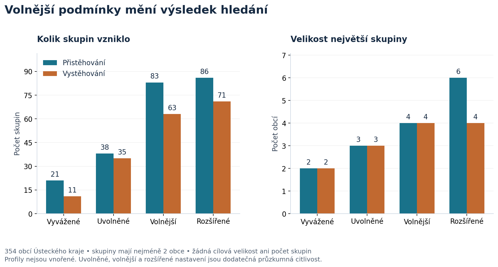
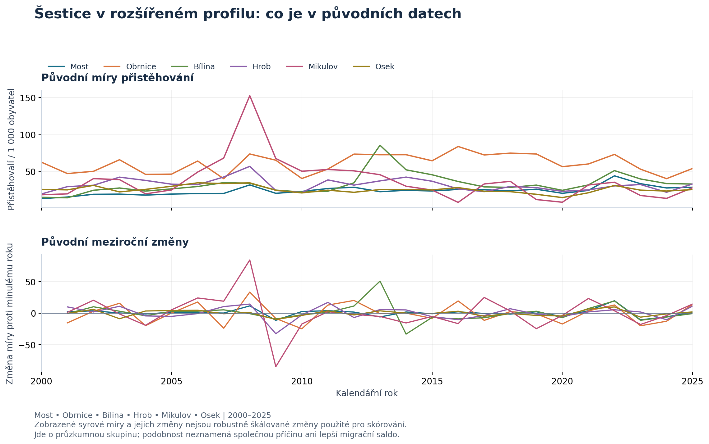
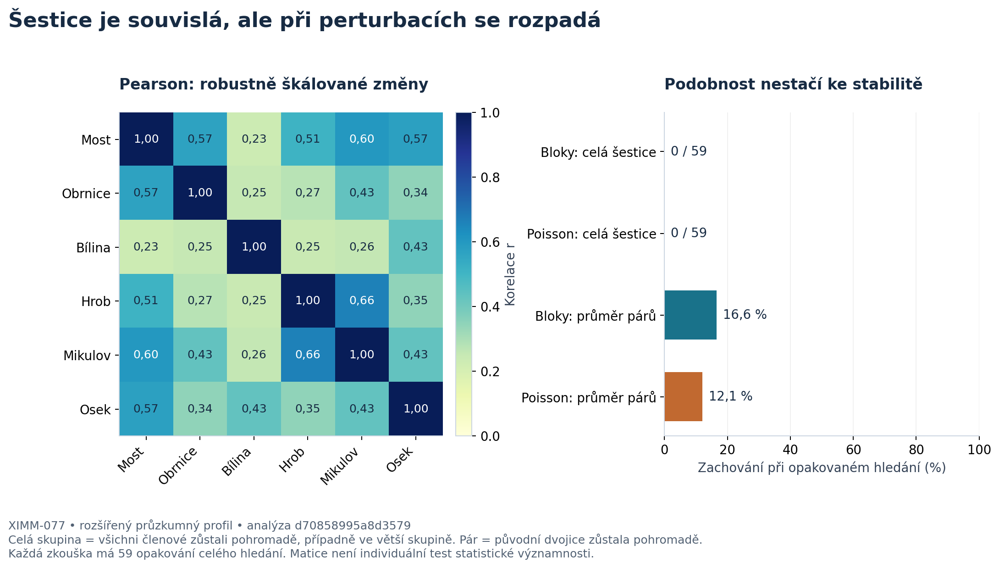

# Výběr migračních klastrů a sousedních mikroskupin

**Které obce Ústeckého kraje zažívají podobné změny migrace ve stejných letech?** Tato složka obsahuje celý zdrojový algoritmus, vstupy a výsledky tohoto hledání. Nejde o mapovou aplikaci: výpočty lze spustit samostatně a prohlížet jejich tabulky, zprávy a grafy.

Největším místním nálezem při uvolněných podmínkách je šestice **Most–Obrnice–Bílina–Osek–Hrob–Mikulov** pro přistěhování. Je ale velmi nestabilní. Celá se nezachovala ani jednou z 59 blokových a ani jednou z 59 Poissonových opakování. Výsledek je hypotézou k průzkumu, nikoli potvrzením společného migračního sektoru.

## Co je uvnitř

- `ustek_analytics/`: šest původních analytických modulů pro přípravu rysů, hierarchii, časovou analýzu, zprávu, prostorové vztahy a lokální skupiny.
- `audit_dcuk1_2026-10-23/sources/`: původní `uloha1_obce_rok_final.csv`, `migrace_vek_obce_rok.csv`, `obce_ciselnik.csv` a `obce_ustecky_kraj.geojson`; součástí předání jsou také kontrolní geografická data.
- `results/`: lehké exporty čtyř lokálních profilů a metodické zprávy. Rozsáhlé generované časové a párové výstupy nejsou uložené v Gitu; vytvoří je úplný přepočet.
- `grafy/`: přiložené grafy a podklady. `vygenerovat_grafy.py` umožňuje obrázky znovu vytvořit.
- `run_analysis.py`, `overit.py`: vstupní příkazy pro reprodukci a ověření.

Číselné výsledky popisují stejný datový řez **354 obcí, roky 2000–2025**. Přistěhování a vystěhování jsou dvě samostatné analýzy. Saldo se nepoužívá: současný nárůst příchodů i odchodů by v něm mohl zmizet.

## Výsledky v kostce

Původní celokrajské časové hledání vytvořilo před kontrolou stability 110 kandidátních skupin přistěhování pro 342 obcí a 107 skupin vystěhování pro 340 obcí. **Žádná skupina neprošla konečným filtrem robustnosti.** V robustním výsledku jsou proto všechny obce `UNASSIGNED`; kandidáti jsou uchovaní k průzkumu.

Následné lokální hledání navíc vyžaduje územní souvislost. Podmínky se na žádost postupně uvolňovaly:

| Profil | Shoda směru | Pearson i Spearman nejméně | Skupiny přistěhování / vystěhování | Větší nálezy |
|---|---:|---:|---:|---|
| `balanced` | 70 % | 0,40 | 21 / 11 | pouze dvojice |
| `relaxed` | 65 % | 0,30 | 38 / 35 | 3 trojice / 3 trojice |
| `loose` | 60 % | 0,20 | 83 / 63 | 1 čtveřice / 2 čtveřice |
| `extended` | 60 % | 0,15 | 86 / 71 | 1 šestice / žádná skupina 5+ |

U uvedené šestice všech 15 dvojic splňuje prahy rozšířeného profilu. Průměrný Pearson je 0,410, nejnižší Pearson 0,234 a Spearman 0,245; průměrná shoda směru je 68,8 %. Největší vzdálenost mezi středy obcí činí 21,82 km. **Průměrná párová retence je pouze 16,6 % v blokové a 12,1 % v Poissonově kontrole.** To je jiná veličina než zachování všech šesti členů pohromadě, které je v obou kontrolách 0/59.



Graf porovnává výsledky při postupném uvolňování podmínek. Více nálezů neznamená lepší doložení podobnosti; každý profil používá jiný práh.

## Jak se počítá podobnost

Základem jsou skutečné počty a míra `1000 × migranti / pocet_obyvatel_1_7`. Jmenovatelem je počet obyvatel k 1. červenci; **nejde o lednovou populaci používanou jinými pohledy či radarem**. Audit brání dvojímu přičítání věkových kategorií a souhrnů. Chybějící hodnota není nula. Neinterpoluje se a meziroční změna nesmí překlenout chybějící kalendářní rok. Rok 2000 nemá předchozí změnu.

Vybranou větví pro přistěhování je Poisson–Gamma empirické Bayesovo vyhlazení s jedním časově konstantním priorem. Pro vystěhování je vybrána nevyhlazená `baseline`. Vyhlazení nevkládá obcím společnou každoroční krajskou křivku. Tyto větve byly vybrány v původní časové analýze; lokální hledání je znovu nevybírá.

Porovnávají se první diference v přesně stejných kalendářních přechodech. Hybridní vzdálenost má směrovou váhu **0,85**; zbývajících 0,15 připadá na korelační část kombinující Pearson a Spearman robustně škálovaných a omezených změn. Korelace v těchto výsledcích proto nemusí být stejná jako neořezaná korelace skutečných měr. Dvě nerozhodnutelné změny se automaticky nepočítají jako shoda. Čas se neposouvá, nepoužívá se DTW ani velikost obce jako shlukovací rys.



Graf ukazuje skutečné roční míry a jejich meziroční rozdíly. Není to robustně ořezaná vstupní metrika algoritmu; umožňuje vidět původní průběhy, odlehlé změny a rozdíly mezi obcemi.

## Jak vzniká souvislá skupina

Sousedství je typu **rook**: obce musí sdílet úsek hranice s nenulovou délkou; dotyk v rohu nestačí. Lokální algoritmus začíná jednotlivými obcemi. Sloučit lze jen geograficky propojené skupiny a všechny dvojice napříč sloučením musí mít nejméně **12 společných informativních změn** a splnit všechny tři prahy profilu.

Z přípustných sloučení se zvolí nejmenší nejhorší párová hybridní vzdálenost, tedy princip complete linkage. Shody rozhoduje kód obce. Hledání končí, když další přípustné sloučení neexistuje. Počet skupin ani jejich horní velikost nejsou zadány. Nezařazené jednotlivé obce zůstávají `UNASSIGNED`.

Celá skupina je souvislá, ale každá dvojice nemusí přímo sousedit. Kontrola všech párů brání řetězci s navzájem nepodobnými krajními členy. Jde o deterministický chamtivý postup: **není zárukou globálního optima ani výčtem všech překrývajících se skupin**. Jiný práh může změnit pořadí slučování, takže profily nejsou nutně vnořené.

## Nejistota a správná interpretace

Každý lokální profil a migrační směr opakuje celé hledání v 59 společných blokových převzorkováních, 59 Poissonových perturbacích a 199 nulových replikacích. Bloky mají délku tři roky a převzorkují již vypočtené změny. Poissonova kontrola zachovává populaci a chybějící hodnoty, znovu odhaduje prior i rysy. Nemusí však vystihovat rodinné přesuny nebo nadměrný rozptyl.

Nulová diagnostika nezávisle kruhově posouvá změny obcí a porovnává celokrajské počty nálezů. **Není exaktní statistickou významností jednotlivých skupin.** Vyžaduje přibližnou kruhovou stacionaritu. Uvolněné profily byly vybrány adaptivně po prohlédnutí předchozích výsledků; diagnostika neopravuje tento opakovaný výběr prahů. Všechny místní nálezy zůstávají průzkumné. Korelace neprokazuje příčinu ani přímé stěhování osob mezi členy skupiny.



Matice 6 × 6 obsahuje robustní Pearsonovy korelace používané v analýze. Srovnání retencí rozlišuje průměr zachovaných párů od zachování celé šestice: část dvojic může přežít, i když celý celek nepřežije ani jednou.

## Reprodukce

Použijte Python 3.11+ a z kořene této složky spusťte:

```sh
python -m pip install -r requirements.txt
python run_analysis.py --check-inputs
python overit.py
python overit.py --real-data
python run_analysis.py
```

První kontrola ověří dostupnost vstupů. `overit.py` spouští syntetické kontroly; `--real-data` navíc ověří bodové lokální hledání všech čtyř profilů nad skutečnými vstupy. Úplný přepočet vytvoří i těžké generované výsledky a opakuje nákladné validační běhy; není potřebný k přečtení přiložených zpráv.

Pro obnovu grafů nainstalujte zvlášť `python -m pip install matplotlib==3.10.8` a spusťte `python vygenerovat_grafy.py`. Grafy slouží k porovnání profilů, podobnosti a stability; větší barevná skupina sama o sobě není silnější důkaz. Manifesty výsledků uchovávají parametry a otisky pro dohledatelnost běhů. Mapové rozhraní je samostatné; tento adresář předává výpočetní část a její výsledky.

Původ souborů a otisky zachycuje [PROVENIENCE.json](PROVENIENCE.json), konkrétní kontroly a jejich stav [protokol ověření](reports/OVERENI.md). Spouštěcí wrappery automaticky zapínají UTF-8 také kvůli českým názvům ve Windows.
